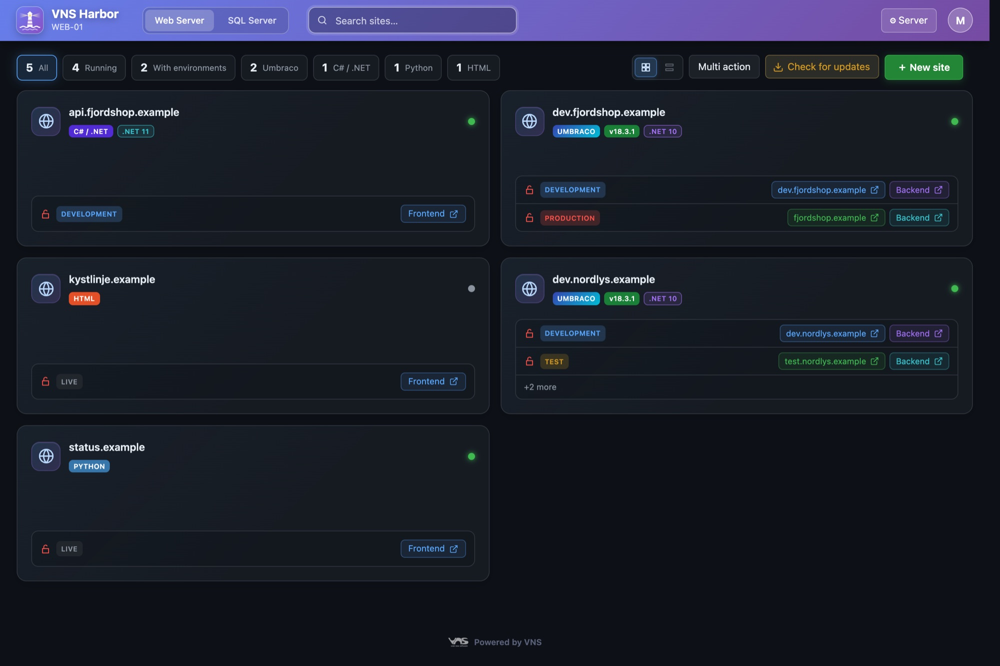
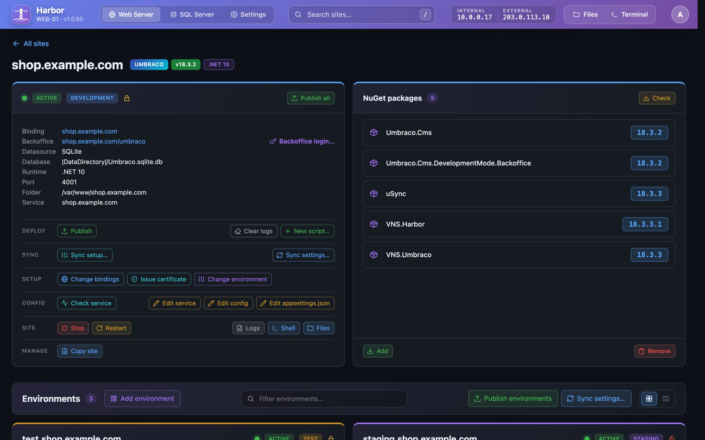
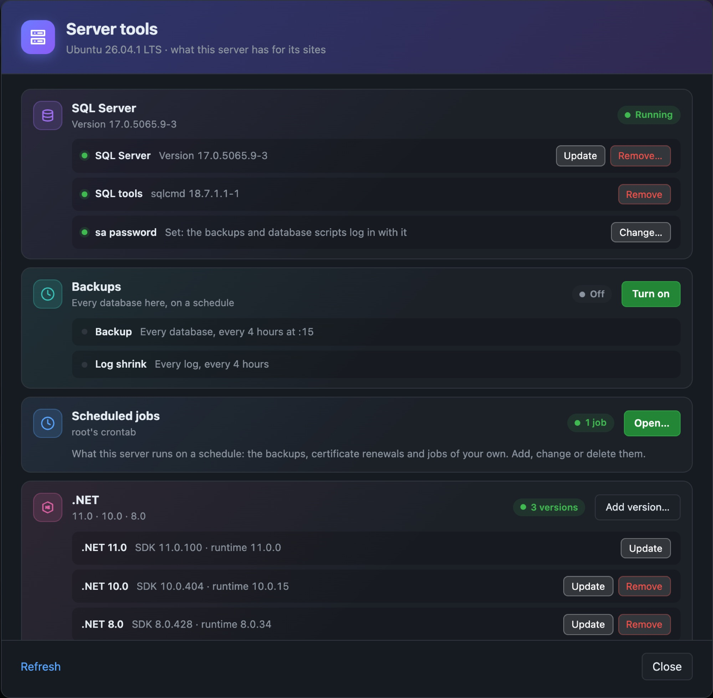
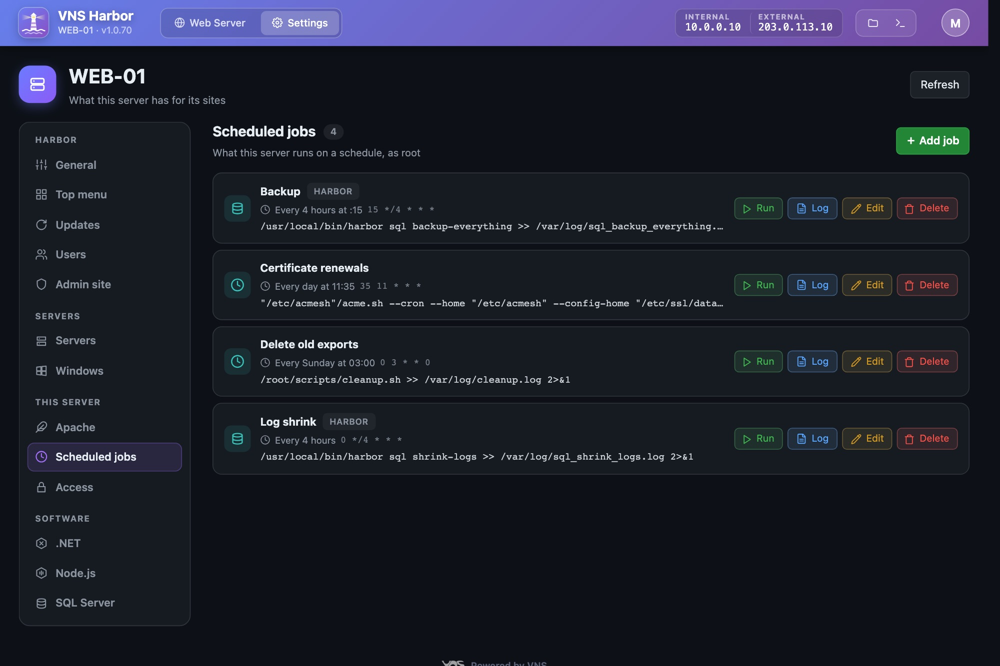
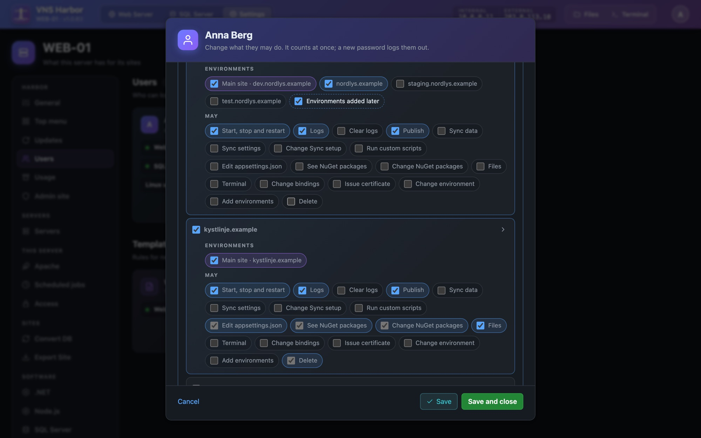

# VNS Harbor

<p align="left">
  
</p>

VNS Harbor hosts and manages web sites on an Ubuntu server: Apache with Let's Encrypt certificates, .NET and Umbraco,
Python and static sites, SQL Server with backups, and each site's environments (Development, Test, Staging,
Production) on this server, other Linux servers or IIS on Windows.

It is one command, `harbor`, and a web admin that runs it. Harbor runs as root; the sites run as `www-data`, each in a
sandbox of its own, and builds run as the unprivileged user `vns-build`.

## Screenshots

<p align="center">
  
  
</p>

<p align="center">
  
  
</p>

<p align="center">
  
  
</p>

## Installation

On a new Ubuntu server, as root:

```bash
apt-get update && apt-get install -y curl    # a minimal Ubuntu has no curl
curl -fsSL https://raw.githubusercontent.com/schlagerdk/VNS.Harbor/main/install.sh | bash
```

`install.sh` does three things:

1. **Base setup:** the time zone (Europe/Copenhagen), time sync, updates, and the few packages Harbor needs.
2. **Harbor:** the newest release in `/opt/harbor`.
3. **The server:** made ready for sites with `harbor server init` (Apache and its modules, acme.sh, .NET 11, 10 and 8, the Umbraco and VNS templates, when wanted (it asks) a Samba share of / as root named by the server's short name, with a Samba password for root it asks for, the keep-alive job). Then it offers to set up the admin site (`harbor admin install`).

`HARBOR_REF=v1.0.0` installs that release instead of the newest.

The admin site asks for:

- its folder and address
- HTTPS (a Let's Encrypt certificate) or plain HTTP
- the first user and their password (at least 12 characters)
- the IP addresses allowed in

**The admin gives root access to the server:** restrict it to your own addresses.

## Updating

From the admin: ⚙ Server → **Update**. Or on the server:

```bash
sudo harbor self update            # the newest release
sudo harbor self update --ref v1.0.0
```

An update fetches the release from GitHub and lets that release install itself (`harbor self finish-update`). The
release is copied whole to `/opt/harbor/releases/<version>` and made the one in use (`/opt/harbor/current`); the three
newest are kept, and a rollback goes back to the one before, the admin with it: **Roll back to …** on a server's card in
the Servers window, or `sudo harbor self rollback`. The release then brings the server up to
date (`harbor self after-update`):

- the server-wide Apache configs and the keep-alive job
- Harbor's copy of the sites' state
- the sa password and the backup jobs
- the admin site

## Uninstalling

In a terminal on the server (not the admin's own: the admin goes first):

```bash
sudo harbor self uninstall
```

It asks for the server's name to confirm (`--yes` does without). Then it takes off:

- the admin site
- the Linux users Harbor made, with their site groups, ACLs and SFTP
- Harbor's jobs: the backups, the log shrinks and keep-alive
- its state (`/var/lib/harbor`) and secrets (`/etc/harbor`)
- `/opt/harbor` and the `harbor` command

**The sites go on running as they are:** their folders, services, Apache configs and certificates stay, and so do
SQL Server, .NET and Apache's server-wide configs (the TLS policy and the offline page).

Before anything goes, Harbor's state and secrets are kept in `/root/harbor-<time>.tar.gz` (root only). They are the
sites' settings, environments and logins, so keep the archive safe or delete it.

To take Harbor off another server it manages: Servers → **Remove**, with **Uninstall Harbor there**. That removes only
`/opt/harbor` and the command there.

## On the server

| Path | What it is |
| --- | --- |
| `/opt/harbor/current` | The release in use: `bin/harbor`, `harbor/`, `admin/`, `lib/`, `templates/` |
| `/opt/harbor/venv` | The admin's Python (Flask, gunicorn) |
| `/usr/local/bin/harbor` | The command |
| `/var/www/<site>` | A site: its project or files, and its publish folder (`_publish`, `_development`, ...) |
| `/var/www/<admin>/app` | The admin's data: its login (`config.json`), audit log, SQL connections, front-end libraries |
| `/var/lib/harbor` | Harbor's state: each site's settings, environments, Sync setup and publish status, other servers, backups |
| `/etc/harbor/secrets` | Passwords and keys (root only): environments' logins, the sa password, Harbor's SSH key |

A site has no scripts of its own: what it does (publish, sync, clear logs, its service and Apache config) is a
`harbor` command, and the admin runs it. A site's own scripts in its `scripts` folder stay, and the admin runs them.

## The command

`harbor --help` lists the groups, and `harbor <group> --help` their commands:

| Group | What it does |
| --- | --- |
| `site` | A site here: create, set up, copy, move, delete, publish, bindings, certificate, service, permissions |
| `env` | A site's environments: create, publish, sync settings and data, move, register, bindings, logs |
| `server` | This server: init, status, Apache, cron jobs, .NET, Node.js |
| `sql` | The local SQL Server: install, databases, backups, restore, the sa password |
| `servers` | Other servers Harbor installs and updates over SSH |
| `users` | A Linux user for each admin user: site folders, a locked-down terminal, SFTP |
| `admin` | The admin site: install, update, set-password, uninstall |
| `self` | Harbor itself: update, releases, rollback |
| `migrate` | Moves a site that still has scripts in its folder into Harbor |

## The admin

The admin site is the web page for all of it:

- the sites and their environments, publishing, syncing settings and data, and Sync setup
- certificates and bindings
- files with an editor, logs, terminals
- NuGet packages and update checks
- SQL Server databases and backups
- Server tools: SQL Server, .NET, Node.js and cron jobs
- other servers, and users with access per site

Each action runs as a task with its steps shown as they come, and its output folded out when something fails.

## VNS.Harbor for Umbraco

The NuGet package [VNS.Harbor](https://www.nuget.org/packages/VNS.Harbor) (Umbraco 18; its versions follow Umbraco's) links a site to the
Harbor that publishes it:

- The admin's **Backend** button logs straight into the backoffice.
- A **VNS Harbor** dashboard lets editors sync settings and data to the site's environments.

A new Umbraco site gets the package; the source is in `nuget/`, with its own README in `nuget/docs`.

## Requirements

- Ubuntu (26.04 is what Harbor is tested on), Python 3.10 or newer
- root, and internet access to GitHub, nuget.org, the .NET installer and Let's Encrypt

## Development

- `tests/` and `tests/admin/`: run them on a Linux test server with `dev/test.sh [host] [module ...]` (bash and the programs as on the servers). GitHub runs them on every push.
- `tests/legacy/` is the scripts Harbor replaced, as they were. Many tests compare harbor with them, and they are never part of a release.
- `dev/deploy.sh [host]` installs this working copy on a test server the way an update does.
- `dev/HARBOR.md` is the plan: what is done, and why.
